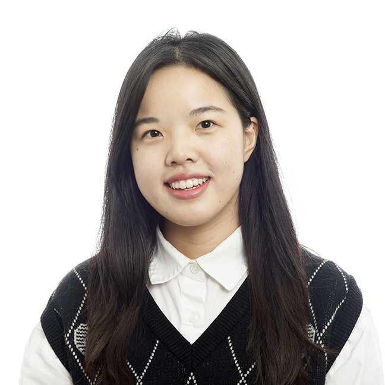

:::{.grid .gap-4 .align-items-start}
::: {.g-col-12 .g-col-md-4}
{width=50% fig-align="left" style="border-radius:12px"}

<i class="fa-brands fa-github"></i> [GitHub](https://github.com/dufengtong)  
<i class="fa-brands fa-x-twitter"></i> [Twitter](https://x.com/Du_Fengtong)  
<i class="fa-solid fa-graduation-cap"></i> [Google Scholar](https://scholar.google.com/citations?user=-gOMrS4AAAAJ&hl=en)

:::

::: {.g-col-12 .g-col-md-8}
Hi! I'm Fengtong (Farah) Du, an **AI Engineer at [HHMI Janelia](https://www.janelia.org/)**. I work on post-training vision foundation models for microscopy images as part of the AI@HHMI MIA-AI project.

I received my PhD in neuroscience in August 2026 from the [Janelia–JHU Joint Neuroscience Graduate Program](https://www.janelia.org/you-janelia/students-postdocs/joint-graduate-program), advised by [Carsen Stringer](https://www.janelia.org/people/carsen-stringer). I studied how the mouse visual cortex learns to recognize things despite changes in position, scale and appearance, and how unsupervised visual experience reshapes those representations. My PhD work combined experiments and computation: I collected my own large-scale neural recordings with calcium imaging, and built simplified deep network models to interpret what individual neurons compute. Representation learning and interpretability are still the questions I care about most.

I also love teaching and explaining complex ideas simply. I've been a TA for Neuromatch Academy, the Cajal NeuroAI Summer School and a probabilistic machine learning course at Janelia. See [Talks & Teaching](academia/index.qmd).

Outside work, I enjoy Chinese philosophy, Russian literature, writing and music. I also love occasional spontaneous adventures close to home.

Welcome to check out my [CV](assets/cv-dufengtong.pdf)!
:::
:::

## News

- **Dec 2026** — Attending [NeurIPS 2026](https://neurips.cc/) in Atlanta.
- **Sep 2026** — Joined HHMI Janelia as an AI Engineer (AI@HHMI / MIA-AI), working on vision foundation model post-training.
- **Aug 2026** — Defended my PhD thesis and graduated from the Janelia–JHU Joint Neuroscience Graduate Program.
- **2025** — [*A simplified minimodel of visual cortical neurons*](https://www.nature.com/articles/s41467-025-61171-9) published in *Nature Communications*.
- **2025** — TA at the [Cajal NeuroAI Summer School](https://cajal-training.org/on-site/neuro-ai/): designed [tutorials](https://github.com/MouseLand/course-materials/tree/main/visual_models) and mentored student projects on foundation models and JEPA.
